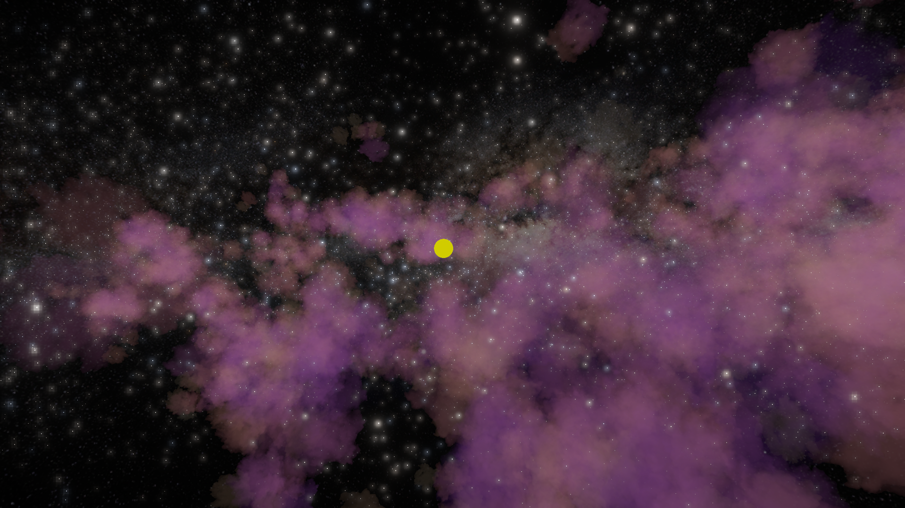
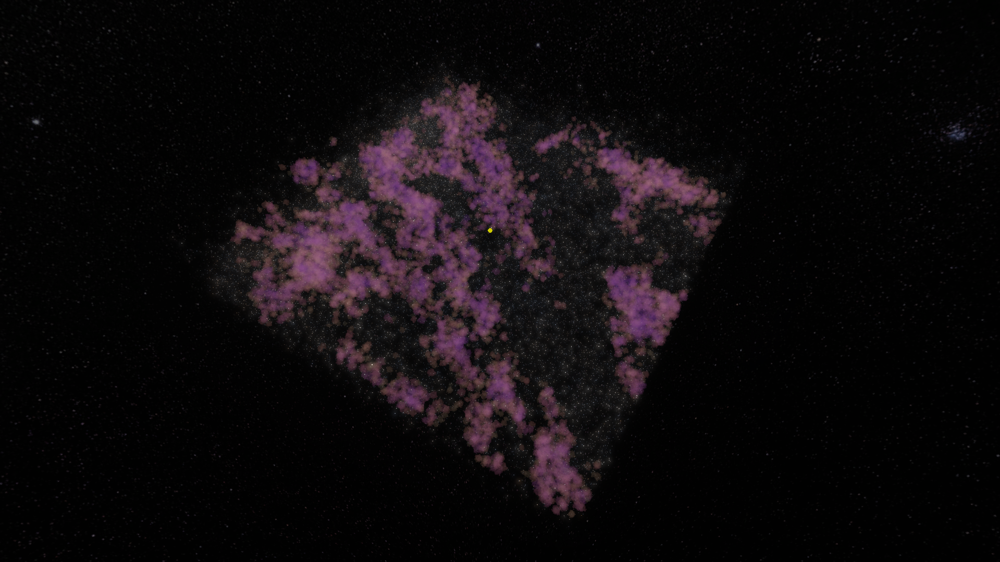
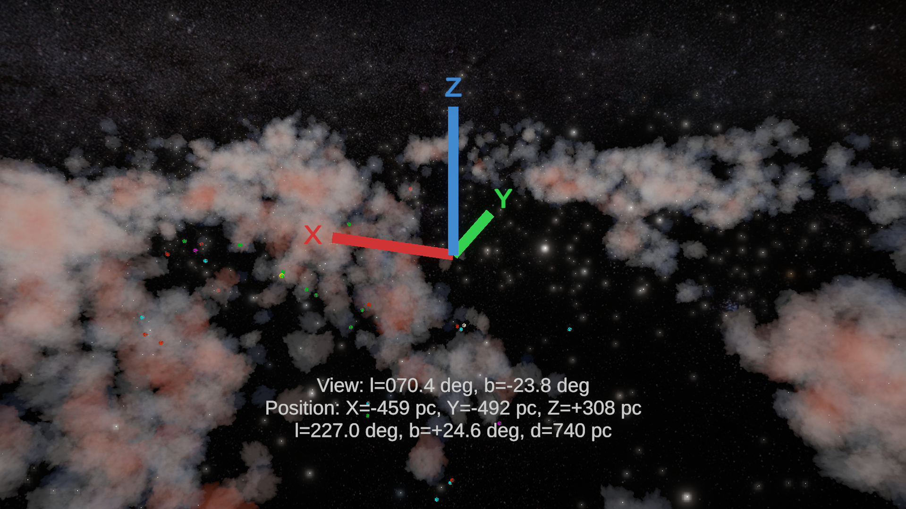
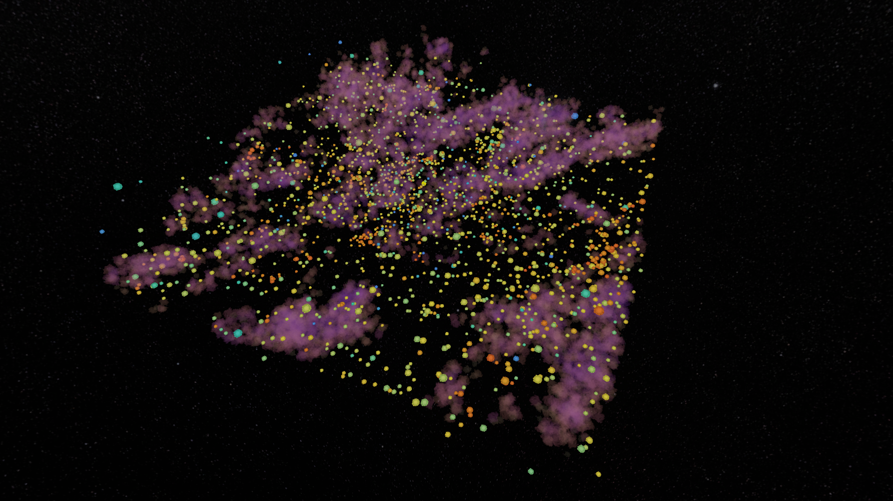
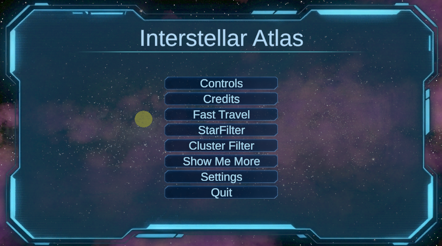

# Interstellar Atlas





## Usage

If you wish to clone this repo or install the app please check Releases.

## Project Team and Acknowledgments

This project was developed within the **Star Formation and Interstellar Medium Laboratory** at the **Technion – Israel Institute of Technology**, under the scientific guidance and supervision of **Prof. Shmuel Bialy**.

The project evolved through the contributions of the following team members:

- **Prof. Shmuel Bialy** — Scientific guidance, project supervision, and research direction.
- **Benny Bairrington** — Initiated the development of the VR space simulation for visualizing interstellar dust.
- **Zakhar Pecherichny** — Continued the project by extending the simulation to include stars.

We acknowledge the contributions of everyone involved in the development of the project and the scientific work that guided it.

## Structure
The scripts files are located under `Scripts/` folder; There are data download + processing python scripts, and installation to the VR headset scripts.

This project uses third-party astronomical data and imagery. These materials are subject to their respective licenses and terms; they are not automatically covered by this project's MIT license.

The project uses the following data:
- Milky Way Background
- Gaia DR3 Star Catalogue. For more information about the usage read `Docs/STARS_README.md`
- Open Cluster Catalogue. For more information about the usage read `Docs/CLUSTERS_README.md`
- Molecular Cloud Landmarks
- Three-Dimensional Dust Map

The credits for the Datasource can be found at `Docs/CREDITS.md`

## Galactic Coordinate System In Unity

The simulation uses a **right-handed Galactic Cartesian coordinate system**, centered on the Sun `(0, 0, 0)`.

**Galactic axes:**
- +X: Galactic Center
- +Y: Galactic longitude 90°
- +Z: North Galactic Pole

**Galactic → Unity conversion:**

```text
Unity X = Galactic X
Unity Y = Galactic Z
Unity Z = Galactic Y
```

**Unity → Galactic conversion (HUD):**

```text
Galactic X = Unity X
Galactic Y = Unity Z
Galactic Z = Unity Y
```

This conversion is applied consistently to positions and directions, ensuring that the Unity simulation and Galactic coordinate HUD use the same coordinate convention.